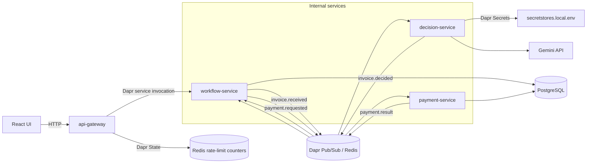
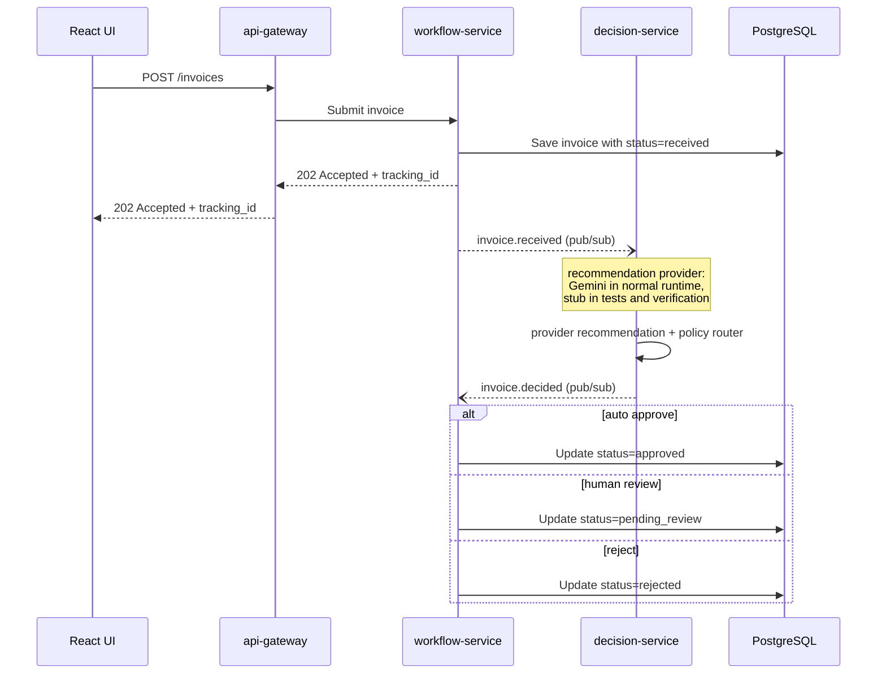
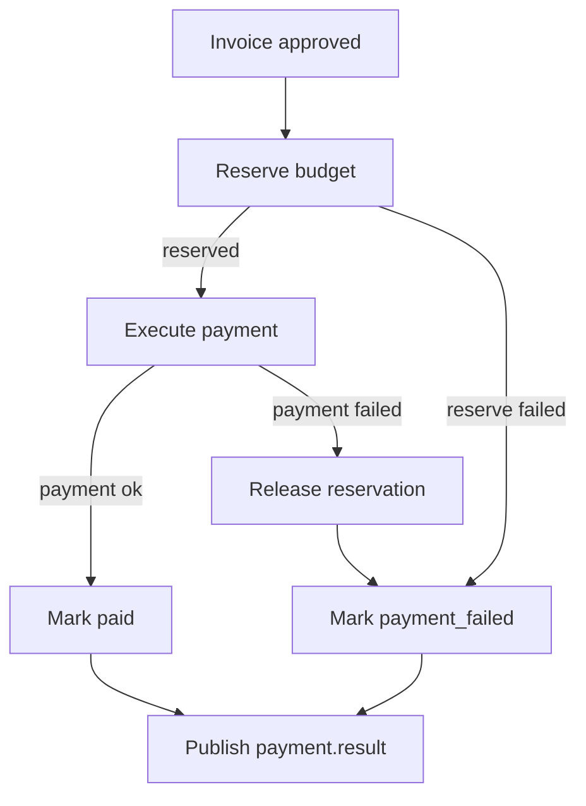

# ApprovalFlow — Architecture

## Overview

ApprovalFlow is designed as a small microservices system for invoice and expense approval. The system accepts submissions, checks them against company policy, routes simple safe items to automatic approval, and escalates risky or unclear items to a human approver.

## Components and boundaries

### UI

The React UI is the user-facing part of the system. Submitters use it to create invoice submissions and check status. Approvers use it to review escalated items.

The UI talks only to the API Gateway.

### api-gateway

The API Gateway is the only backend service exposed to the UI. It receives external requests, performs basic validation, keeps the public API in one place, and forwards internal work to the relevant service.

It should not contain approval rules or payment logic.

### workflow-service

The workflow service owns the approval process state. It tracks the invoice throughout the workflow, including `received`, `pending_review`, `needs_more_info`, `approved`, `rejected`, `duplicate`, `payment_requested`, `paid`, and `payment_failed`.

It coordinates the next step, but it should not contain the full decision policy.

### decision-service

The decision service evaluates an invoice against the company policy. It may use an agent recommendation as one input, but deterministic code must enforce the final route.

It returns a route such as auto-approve, human review, or reject. It must not execute payments.

### payment-service

The payment service handles the payment flow after an invoice is approved. It is responsible for payment idempotency and compensation if a payment step fails.

It should not decide whether an invoice is allowed to be approved.

## Data ownership

PostgreSQL is the durable source of truth for invoices, decisions, review actions, duplicate relationships, payments, department budgets, and notifications.

`workflow-service` owns:

- invoice status and revision
- stored decisions
- review history
- duplicate relationships
- notification records
- dashboard and audit-trail read models

`payment-service` owns:

- `payments`
- `budget_accounts`
- reservation, spending, and compensation transitions

The audit trail is not a separate event store. It is a read-only view assembled from durable data already owned by the workflow and payment domains.

Redis is used through Dapr for Pub/Sub transport and temporary rate-limit counters. Redis is not the source of truth for business records.

## Dapr sidecars

Each backend service runs with a Dapr sidecar.

The system uses Dapr for:

- synchronous service invocation from `api-gateway` to `workflow-service`
- asynchronous Pub/Sub for the four business topics
- state storage for API Gateway rate-limit counters
- secret retrieval for the Gemini API key

The four Pub/Sub topics are:

- `invoice.received`
- `invoice.decided`
- `payment.requested`
- `payment.result`

Redis backs Dapr Pub/Sub and State in local Docker Compose.

The `decision-service` sidecar exposes the Gemini key through the Dapr Secrets API. The raw key is supplied locally through `.env`, is not committed, and is not exposed to the UI, Gateway, Workflow, or Payment services.

## System diagram

## Invoice and review flow

The implementation covers asynchronous decision routing, durable human review, duplicate detection, notifications, and the payment saga. Dapr Pub/Sub uses four topics: `invoice.received`, `invoice.decided`, `payment.requested`, and `payment.result`.

1. A submitter creates an invoice in the UI.
2. `api-gateway` validates the request and forwards it to `workflow-service`.
3. `workflow-service` stores the invoice with status `received` and returns a `tracking_id`.
4. The `invoice.received` event is published in the background. A retry sweep republishes invoices whose event was not published successfully.
5. `decision-service` obtains a recommendation from the provider selected by `RECOMMENDATION_PROVIDER`. Normal runtime uses Gemini; tests, CI, and verification explicitly use the deterministic stub.
6. `decision-service` validates the provider output, applies the deterministic policy router, and publishes `invoice.decided` with the recommendation, confidence, provider metadata, final route, rule IDs, and explanation.
7. `workflow-service` updates the invoice to `approved`, `pending_review`, or `rejected`. Both event consumers are idempotent, so a re-delivered event does not change the invoice twice.
8. Invoices in `pending_review` remain in the Approver Queue until a reviewer approves, rejects, or requests more information.
9. Approved invoices continue automatically into the payment flow below, ending in `paid` or `payment_failed`.

## Human review

Invoices with status `pending_review` appear in the Approver Queue. A reviewer can perform one of three actions:

- `approve` changes the status to `approved`.
- `reject` changes the status to `rejected`.
- `request_more_info` changes the status to `needs_more_info` and stores the reviewer's request.

In the current version, an approved or rejected invoice cannot be reviewed again.

When additional information is submitted, the invoice returns to `received` and is evaluated again. It keeps the same `tracking_id` and `correlation_id`.

The review state is stored in PostgreSQL. The invoice status, current decision, revision, and review request time are stored with the invoice, while human actions are stored in the `review_actions` table. Pending reviews and action history therefore remain available after a service restart.

Review transitions use an atomic update that succeeds only while the invoice is in `pending_review`. This prevents a repeated or concurrent action from overwriting the first completed review. Each request also includes an idempotency key, so retrying the same action does not create another history record.

Each evaluation round has an integer `revision`. The first evaluation uses revision 1, and the number increases when additional information is submitted. The revision is included in both `invoice.received` and `invoice.decided`.

`workflow-service` applies a decision only when the event revision matches the current invoice revision. A late decision from an older round is acknowledged without updating the invoice.

## Duplicate detection

A submission is treated as a business duplicate when its vendor, invoice number, currency, and amount match an invoice that already exists. Before comparison, the vendor is trimmed and lowercased, the invoice number and currency are trimmed and uppercased, and the amount is normalized to two decimal places. Submissions without an invoice number are not checked, because vendor and amount alone cannot distinguish two legitimate expenses.

`workflow-service` runs the check when the invoice is stored, before `invoice.received` is published. A duplicate still gets its own record and tracking ID, with status `duplicate`, a `duplicate_of` link to the original, and a stored decision containing the `GLOBAL-DUP` rule. It is not sent to `decision-service` and does not enter the approver queue, so its decision has no recommendation or confidence fields.

PostgreSQL enforces the duplicate key with a partial unique index. If two identical submissions arrive at the same time, one becomes the original and the other is stored as a duplicate linked to it. The same check runs when an invoice in `needs_more_info` later receives an invoice number: if that number already belongs to another invoice, the invoice is marked as a duplicate instead of being re-evaluated.

Existing rows are not backfilled with duplicate keys, so detection covers invoices submitted after the feature was added.

## Invoice sequence

## Payment flow and compensation

Payment starts automatically when an invoice becomes `approved`, through either the automatic route or a human approve action. `workflow-service` moves the invoice to `payment_requested` with a guarded update and publishes `payment.requested`; `payment-service` runs the money steps and publishes `payment.result`, which sets the final invoice status to `paid` or `payment_failed`.

Rules for this flow:

- If budget reservation fails because the budget is insufficient, the department is missing, or no matching budget account exists, the payment is marked as failed. No compensation is needed because no budget was reserved.
- If execution fails after a reservation, `payment-service` marks the payment as failed and releases the reservation in the same transaction. A repeated call does not release it again.
- The `payments` table has a unique constraint on `tracking_id`, so one invoice can have at most one payment record.
- Payment and budget updates use guarded database transitions. Replayed events and retries therefore return the stored outcome without moving money again.

`payment-service` owns the `payments` and `budget_accounts` tables in PostgreSQL. Budgets are stored per department in USD and are seeded from `data/budgets.json`. The total, reserved, and spent values use PostgreSQL `NUMERIC`.

Budget reservation uses one conditional update that succeeds only when enough budget remains. This prevents concurrent approvals from spending more than the account balance.

The local payment provider is deterministic. Invoice numbers that match a configured `PAYMENT_FAIL_INVOICE_NUMBERS` prefix are declined, while other valid payments succeed. This allows the repeatable `RS-90021-<run-suffix>` verification scenario while keeping each verification invoice unique. No real bank integration is used.

A recovery sweep resumes payments left in `reserved` after a crash and republishes terminal results whose successful publication was not recorded. Existing approved invoices have no `payment_flow_version` and are excluded from the approved-invoice recovery sweep.

## Decision boundary

The core rule of the system: **the agent can recommend, but code decides.**

An agent may score an invoice or suggest a route, but its output is only one input to decision-service. Deterministic code applies the policy thresholds and makes the final routing decision. Expensive, risky, unclear, incomplete, or suspicious items must never be auto-approved on an agent's recommendation alone.

## Recommendation providers

`decision-service` uses a swappable `RecommendationProvider` abstraction.

Supported providers:

- `gemini` — the normal runtime
- `stub` — deterministic mode for unit tests, CI, and end-to-end verification

Gemini returns only a recommendation, confidence, and short rationale. Its response is requested as structured JSON and validated before use.

The deterministic router remains authoritative. Provider output cannot get past the autonomy ceiling, the vendor registry, or any other configured rule or hard stop.

## Gemini failure path

The Gemini provider retrieves `GEMINI_API_KEY` only through the Dapr Secrets API.

Provider failures are categorized as:

- `missing_secret`
- `authentication_error`
- `timeout`
- `rate_limited`
- `temporary_provider_error`
- `invalid_provider_response`
- `unsupported_provider`

Transient failures use bounded retries. Non-retryable or exhausted failures produce an explicit zero-confidence recommendation.

The deterministic router adds `AI-PROVIDER-ERROR` and routes the invoice to human review. Gemini mode never silently substitutes the stub.

The persisted decision and audit trail include:

- provider
- model
- provider error category
- recommendation
- confidence
- final route
- policy rule IDs

API keys, full prompts, raw provider responses, and secret-store responses are never persisted.

## External policy and vendor registry

`data/policy-config.json` contains autonomy thresholds, confidence thresholds, FX rates, category limits, and the known-vendor registry.

The file is mounted read-only into `decision-service`. The policy loader tracks its modification time and reloads a changed valid configuration before the next evaluation. No image rebuild, container recreation, or service restart is required.

An invalid update never partially replaces the active policy: the broken file is rejected as a whole, affected evaluations are retried through the normal event retry path, and processing resumes automatically once the file is valid again.

The submitter provides a vendor name only. Vendor trust is derived by the system from the configured registry using deterministic normalization. Client-provided trust indicators cannot override the registry.

## Rate limiting and Dapr State

`api-gateway` owns rate limiting.

Only public state-changing operations are limited:

- invoice submission
- approval actions
- additional-information submission

Read operations, health checks, documentation, dashboard queries, notifications, and status polling are not limited.

Counters are grouped by client and route type in fixed one-minute windows. In Docker, they are stored through the Gateway's Dapr State API and backed by Redis. Keys use a TTL so old windows expire.

ETag-based optimistic concurrency with bounded retries reduces lost updates during concurrent requests. When the state store is unavailable, protected writes fail with HTTP 503 rather than bypassing the limiter. Business records never enter Dapr State.

## Notifications, dashboard, and audit trail

`workflow-service` stores notifications for `needs_more_info`, `rejected`, `duplicate`, `paid`, and `payment_failed`.

The business status change commits first, and the notification is written afterwards, idempotently. If a crash lands between the two steps, a recovery sweep creates the missing notification.

The dashboard is a read-only aggregate over durable invoice and review data. It reports throughput, status counts, auto-approved versus human-approved counts, and corresponding USD amounts.

The audit trail collects everything already stored about one invoice into a single view: the submitted data, the decision with its rules and provider details, human actions, duplicates, the payment outcome, and notifications. It does not introduce a separate audit-event store.

## Correlation and logging

Each public request receives or creates a `correlation_id`. The identifier is propagated through service invocation, Pub/Sub events, stored decisions, and payments, and is returned on public responses — including errors — in the `X-Correlation-ID` header. Notifications are linked to the same history through the invoice `tracking_id`.

Application logs use a shared structured JSON format and include the correlation ID on meaningful request, decision, review, duplicate, payment, compensation, rate-limit, notification, and provider-error entries.

Secrets, complete prompts, raw provider responses, and full sensitive payloads are excluded from logs.

## Verification architecture

`make verify`, or `python tests/verification/run.py` on Windows, runs the required acceptance journeys through `api-gateway`.

The runner verifies:

- `INV-1001` — automatic approval and payment
- `INV-1003` — durable human pause and resume
- `INV-1007` — duplicate short-circuit with one payment only
- `INV-1012` — payment failure and compensation
- at least two no-human auto approvals
- the `approve me` anti-steering case
- payment, reservation, duplicate, and budget invariants

Normal runtime defaults to Gemini. Verification temporarily starts `decision-service` in explicit stub mode for deterministic assertions and restores the original Gemini runtime setting in a `finally` path.

Each run uses unique invoice references. Verification records remain in PostgreSQL and are included in cumulative dashboard totals.
