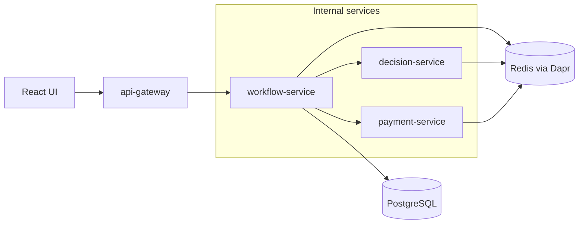
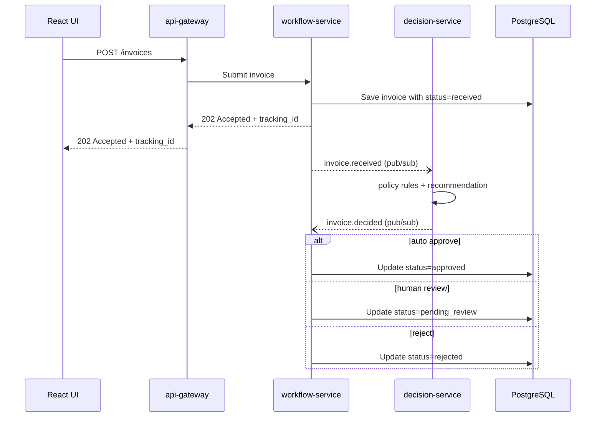
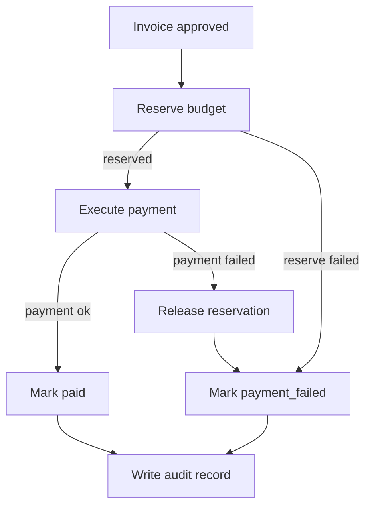

# ApprovalFlow — Architecture

## Overview

ApprovalFlow is designed as a small microservices system for invoice and expense approval. The system accepts submissions, checks them against company policy, routes simple safe items to automatic approval, and escalates risky or unclear items to a human approver.

## Components and boundaries

### UI

The React UI is the user-facing part of the system. Submitters use it to create invoice submissions and check status. Approvers use it to review escalated items.

The UI talks only to the API Gateway.

### api-gateway

The API Gateway is the only backend service exposed to the UI. It receives external requests, performs basic validation, keeps the public API in one place, and forwards internal work to the relevant service.

It should not contain approval rules or payment logic.

### workflow-service

The workflow service owns the approval process state. It tracks where each invoice is in the flow: received, waiting for decision, pending human review, approved, rejected, payment requested, paid, or payment failed.

It coordinates the next step, but it should not contain the full decision policy.

### decision-service

The decision service evaluates an invoice against the company policy. It may use an agent recommendation as one input, but deterministic code must enforce the final route.

It returns a route such as auto-approve, human review, or reject. It must not execute payments.

### payment-service

The payment service handles the payment flow after an invoice is approved. It is responsible for payment idempotency and compensation if a payment step fails.

It should not decide whether an invoice is allowed to be approved.

## Data ownership

PostgreSQL stores durable business data such as invoices, decisions, payment records, and audit history. In the first implementation, workflow-service owns the invoice status and workflow state. Payment records and audit data can be added as the payment and verification flows are implemented.

Redis is used through Dapr for pub/sub and transient state. Redis is not the source of truth for business records.

## Dapr sidecars

Each backend service runs with a Dapr sidecar. The services currently use Dapr HTTP APIs for service invocation and pub/sub. State and local secret store components are configured for later workflow and integration needs.

In local development, Redis backs Dapr pub/sub and state.

## System diagram

## Invoice and review flow

The current implementation covers invoice submission, asynchronous decision routing, and durable human review. Dapr Pub/Sub uses two topics: `invoice.received` and `invoice.decided`.

1. A submitter creates an invoice in the UI.
2. `api-gateway` validates the request and forwards it to `workflow-service`.
3. `workflow-service` stores the invoice with status `received` and returns a `tracking_id`.
4. The `invoice.received` event is published in the background. A retry sweep republishes invoices whose event was not published successfully.
5. `decision-service` evaluates the invoice using the external policy configuration and the recommendation provider (currently a local stub).
6. `decision-service` publishes `invoice.decided` with the route, confidence, rule IDs, and explanation.
7. `workflow-service` updates the invoice to `approved`, `pending_review`, or `rejected`. Both event consumers are idempotent, so a re-delivered event does not change the invoice twice.
8. Invoices in `pending_review` remain in the Approver Queue until a reviewer approves, rejects, or requests more information.
9. Approved invoices are ready for the payment flow, which is not implemented yet.

## Human review

Invoices with status `pending_review` appear in the Approver Queue. A reviewer can perform one of three actions:

- `approve` changes the status to `approved`.
- `reject` changes the status to `rejected`.
- `request_more_info` changes the status to `needs_more_info` and stores the reviewer's request.

In the current version, an approved or rejected invoice cannot be reviewed again.

When additional information is submitted, the invoice returns to `received` and is evaluated again. It keeps the same `tracking_id` and `correlation_id`.

The review state is stored in PostgreSQL. The invoice status, current decision, revision, and review request time are stored with the invoice, while human actions are stored in the `review_actions` table. Pending reviews and action history therefore remain available after a service restart.

Review transitions use an atomic update that succeeds only while the invoice is in `pending_review`. This prevents a repeated or concurrent action from overwriting the first completed review. Each request also includes an idempotency key, so retrying the same action does not create another history record.

Each evaluation round has an integer `revision`. The first evaluation uses revision 1, and the number increases when additional information is submitted. The revision is included in both `invoice.received` and `invoice.decided`.

`workflow-service` applies a decision only when the event revision matches the current invoice revision. A late decision from an older round is acknowledged without updating the invoice.

## Invoice sequence

## Planned payment flow and compensation

Payment runs as a short sequence of steps, and each failing step has a compensation path so the system never ends in a half-paid state:

Rules for this flow:

- If the budget reservation fails, the invoice is marked `payment_failed` and an audit record is written. Nothing needs to be rolled back because nothing was charged.
- If payment execution fails after a reservation was made, the reservation is released (the compensation step), the invoice is marked `payment_failed`, and an audit record is written.
- Every terminal outcome (`paid` or `payment_failed`) writes an audit record.
- Payment steps must be idempotent so a retry cannot charge twice.

## Decision boundary

The core rule of the system: **the agent can recommend, but code decides.**

An agent may score an invoice or suggest a route, but its output is only one input to decision-service. Deterministic code applies the policy thresholds and makes the final routing decision. Expensive, risky, unclear, incomplete, or suspicious items must never be auto-approved on an agent's recommendation alone.
