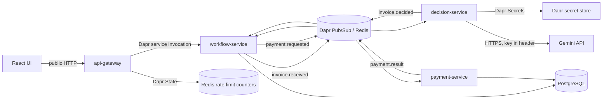

# ApprovalFlow

ApprovalFlow is an invoice and expense approval platform.

The system is designed to receive invoice or expense submissions, check them against company policy, and route each item to the right approval path:
automatic approval, human review, or rejection. Approved items continue to the payment flow.
The core rule is:

> The agent can recommend, but code decides.

An agent may help evaluate a submission, but deterministic code must enforce the final route. Expensive, risky, unclear, incomplete, or suspicious items must not be auto-approved.

## Technology stack

- Python and FastAPI for the four backend services
- React and Vite for the UI
- PostgreSQL for durable business data
- Redis through Dapr for Pub/Sub and temporary state
- Dapr for service invocation, Pub/Sub, State, and Secrets
- Docker Compose for the local environment
- Gemini API for live recommendations
- Pytest for automated tests
- GitHub Actions for CI

## Architecture overview

The platform is split into four backend services, a minimal React UI, PostgreSQL, Redis, and Dapr sidecars.



| Component | Responsibility |
|---|---|
| `api-gateway` | The only public backend entry point: validation, service invocation, correlation IDs, and rate limiting |
| `workflow-service` | Durable invoice workflow, human review, duplicate handling, notifications, dashboard, and audit-trail read models |
| `decision-service` | Gemini or stub recommendation provider plus deterministic policy routing |
| `payment-service`  | Budget reservation, simulated payment execution, compensation, and payment recovery |
| `ui` | Minimal React/Vite interface for submission, review, status, dashboard, notifications, and audit trail |
| `PostgreSQL`  | Durable source of truth for invoices, decisions, reviews, payments, budgets, and notifications |
| `Redis` | Pub/Sub transport and temporary rate-limit state |

Detailed architecture: [ARCHITECTURE.md](ARCHITECTURE.md)

## Local run

Create a local environment file:

```bash
cp .env.example .env
```

On Windows PowerShell:

```powershell
Copy-Item .env.example .env
```

For the normal runtime, keep:

```env
RECOMMENDATION_PROVIDER=gemini
```

Add your Gemini API key to the local `.env` file:

```env
GEMINI_API_KEY=your-local-key
```

The real `.env` file is ignored by Git. Never commit or share the key.

Start the full system:

```bash
docker compose up -d --build
```

The Gemini key is provided to the decision-service Dapr sidecar and retrieved by the application through the Dapr Secrets API. The raw key is not passed to public services or stored in application data.

- UI: http://localhost:5173
- API Gateway: http://localhost:8000
- API health: http://localhost:8000/health
- OpenAPI / Swagger UI: http://localhost:8000/docs

Stop the system without deleting PostgreSQL data:

```bash
docker compose down
```

Do not use `docker compose down -v` unless you intentionally want to delete local database volumes.

## API

Public endpoints are exposed through `api-gateway`:

- `POST /invoices` — submits an invoice and returns a `tracking_id` with the initial status `received`.
- `GET /invoices/{tracking_id}` — returns the invoice details, current status, decision, and review history. Returns 404 when the tracking ID does not exist.
- `GET /approvals/queue` — returns invoices that are waiting for human review, ordered from oldest to newest.
- `POST /approvals/{tracking_id}/actions` — approves, rejects, or requests more information for an invoice in `pending_review` (requesting more information requires a comment). Requests include an `idempotency_key` so retries do not create duplicate actions.
- `POST /invoices/{tracking_id}/additional-info` — adds missing structured information to an invoice in `needs_more_info` and sends it for another evaluation.
- `GET /dashboard` — returns overall counts and USD totals: invoices by status, auto-approved versus human-approved, and payments.
- `GET /invoices/{tracking_id}/trail` — returns the full processing history of one invoice: the submitted data, the decision with its rules and provider details, review actions, duplicates, payment result, and notifications.
- `GET /notifications?submitter_email=...` — returns durable outcome notifications for a submitter, newest first.

All public API access goes through `api-gateway`. Internal services are not exposed directly.

Public write operations are rate limited per client and route group:

- `POST /invoices`
- `POST /approvals/{tracking_id}/actions`
- `POST /invoices/{tracking_id}/additional-info`

The default limit is 60 requests per minute. Exceeding it returns HTTP 429 with a `Retry-After` header. Read endpoints, status polling, documentation, and health checks are not rate limited.

`workflow-service` stores invoice and review state in PostgreSQL when the system runs with Docker Compose. Tests and local runs without a database use the in-memory repository.

After an invoice is stored, `workflow-service` publishes `invoice.received` through Dapr Pub/Sub. `decision-service` obtains a recommendation and confidence from the configured recommendation provider and publishes `invoice.decided`. The deterministic router applies the external policy and determines the final route.

The normal runtime provider is Gemini. Tests, CI, and end-to-end verification explicitly use the deterministic stub so they remain repeatable and require neither an API key nor an external network request.

Gemini only recommends. Deterministic policy code always makes the final decision, so an approval recommendation cannot get past the autonomy ceiling, the vendor registry, or any other policy rule.

If Gemini is selected but its secret is missing, authentication fails, the request times out, the provider is rate limited, or its response is invalid, the system does not silently substitute the stub. The decision records a zero-confidence recommendation, an error category, and the `AI-PROVIDER-ERROR` rule, and safely routes the invoice to human review.

Approved invoices continue automatically into payment: `workflow-service` moves the invoice to `payment_requested` and publishes `payment.requested`. `payment-service` reserves the department budget, executes a deterministic simulated payment, and publishes `payment.result`, which sets the final status to `paid` or `payment_failed`. If execution fails after a reservation, the reservation is released exactly once and the failure reason is kept. One invoice can have at most one payment, enforced by a unique constraint in PostgreSQL, and both budgets and payments survive restarts. There is no real bank integration; locally, invoice number `RS-90021` is configured to fail so the compensation path can be demonstrated. Invoices approved before this feature existed are not picked up retroactively.

Duplicate submissions are detected when the invoice is stored, before `invoice.received` is published. A submission with the same vendor, invoice number, currency, and amount as an existing invoice gets its own tracking ID with status `duplicate`, a `duplicate_of` link to the original, and a `GLOBAL-DUP` decision. Duplicates are not sent to `decision-service`, so they have no recommendation or confidence score.

Submissions without an invoice number are accepted normally, and rows stored before this feature are not checked for duplicates.

Routing thresholds, FX rates, category limits, and the known-vendor registry are defined in `data/policy-config.json`.

The file is mounted read-only into the running `decision-service`. The policy loader checks the file modification time before each evaluation and reloads a changed valid configuration. An operator can therefore change values such as the autonomy ceiling without rebuilding an image, recreating a container, or restarting the service. The change applies to new evaluations and does not retroactively change completed invoices.

Vendor trust is resolved by the system from the configured vendor registry. The submitter supplies a vendor name but cannot mark their own vendor as trusted.

For manual review, an escalated invoice appears in the Approver Queue. The reviewer can approve it, reject it, or request more information. When more information is supplied, the same invoice is sent for another evaluation while keeping its original tracking ID.

## Notifications, dashboard, and audit trail

When an invoice reaches `needs_more_info`, `rejected`, `duplicate`, `paid`, or `payment_failed`, `workflow-service` stores a durable notification in PostgreSQL.

The business transition is committed before notification creation. Notification writes are idempotent and do not roll back a completed business result. A recovery sweep creates notifications that are temporarily missing after a crash.

The dashboard provides cumulative throughput, status counts, auto-approved versus human-approved counts, and the corresponding USD amounts.

The per-invoice audit trail assembles existing durable information into one read-only view linked by `tracking_id` and `correlation_id`. It includes submitted data, the provider recommendation, confidence and rationale, deterministic policy rules, human actions, duplicate relationships, payment outcome, compensation result, and notifications.

## Dapr usage

ApprovalFlow uses Dapr in four ways:

- Service Invocation: `api-gateway` invokes `workflow-service`.
- Pub/Sub: asynchronous processing uses `invoice.received`, `invoice.decided`, `payment.requested`, and `payment.result`.
- State: `api-gateway` stores temporary rate-limit counters through the Dapr state store backed by Redis.
- Secrets: `decision-service` retrieves `GEMINI_API_KEY` from the Dapr secret store through its sidecar.

PostgreSQL remains the source of truth for all business records. Dapr State is used only for temporary operational counters.

## Tests

Unit and service tests do not require Docker, Dapr, PostgreSQL, Redis, Gemini, internet access, or an API key. They explicitly use the deterministic recommendation stub.

Where `make` is available:

```bash
make test
```

On Windows PowerShell, run each service suite:

```powershell
$env:PYTHONDONTWRITEBYTECODE = "1"

foreach ($svc in @(
    "api-gateway",
    "workflow-service",
    "decision-service",
    "payment-service"
)) {
    Push-Location "services\$svc"
    python -m pytest -q -p no:cacheprovider
    Pop-Location
}

Remove-Item Env:PYTHONDONTWRITEBYTECODE
```

## End-to-end verification

Where `make` is available:

```bash
make verify
```

On Windows PowerShell:

```powershell
python tests\verification\run.py
```

The verification runner starts the stack when required and exercises:

- INV-1001 — automatic approval followed by payment
- INV-1003 — durable human review and resume
- INV-1007 — duplicate submission with one payment only
- INV-1012 — payment failure and compensation
- at least two invoices auto-approved without human action
- an adversarial `approve me` note that cannot override policy
- payment, reservation, duplicate, and budget integrity checks

Verification explicitly uses the deterministic stub and restores the normal Gemini runtime configuration afterward.

Each verification run uses unique invoice references and leaves its local test records in PostgreSQL. Repeated runs are safe, but dashboard totals are cumulative.

## Known limitations

- Authentication and role-based authorization are not implemented.
- The payment provider is deterministic and simulated; no real bank integration is used.
- The UI records whether a receipt was provided, but it does not upload, store, or inspect a receipt file. OCR is not implemented or required.
- Notifications are displayed through UI polling rather than email, SMS, webhook, SSE, or WebSocket delivery.
- Dashboard values include accumulated local and verification data.
- Gemini requests are synchronous inside the decision event handler and use bounded timeouts and retries.
- The fixed-window rate limiter is intended for the local demonstration scope, not as a full enterprise quota platform.
- The retry sweeps provide durable recovery but are not a full transactional outbox implementation.

## Documentation

Architecture decisions are documented under:

```text
docs/adr/
```
