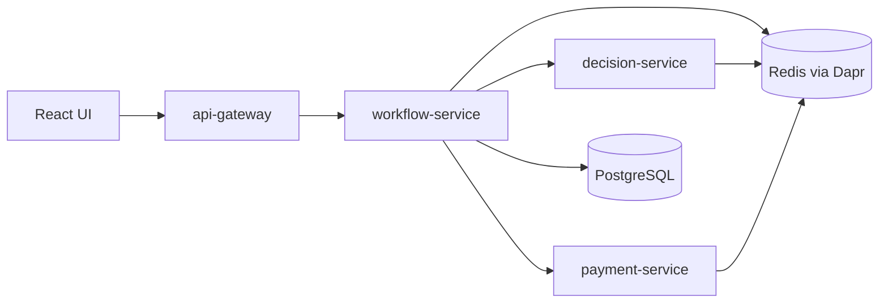

# ApprovalFlow

ApprovalFlow is an invoice and expense approval platform.

The system is designed to receive invoice or expense submissions, check them against company policy, and route each item to the right approval path:
automatic approval, human review, or rejection. Approved items will continue to the payment flow.
The core rule is:

> The agent can recommend, but code decides.

An agent may help evaluate a submission, but deterministic code must enforce the final route. Expensive, risky, unclear, incomplete, or suspicious items must not be auto-approved.

## Architecture overview

The platform is split into four backend services and a minimal React UI.



| Component | Responsibility |
|---|---|
| `api-gateway` | External entry point for the UI |
| `workflow-service` | Tracks invoice state and workflow progress |
| `decision-service` | Applies policy checks, agent recommendation, and deterministic guardrails |
| `payment-service`  | Will handle payment execution and compensation |
| `ui` | Minimal React/Vite frontend |

Detailed architecture: [ARCHITECTURE.md](ARCHITECTURE.md)

## Local run

Create a local `.env` file from `.env.example`, then run:

```bash
docker compose up --build
```

UI: http://localhost:5173  
API Gateway health: http://localhost:8000/health

Stop the system:

```bash
docker compose down
```

## API

Public endpoints are exposed through `api-gateway`:

- `POST /invoices` — submits an invoice and returns a `tracking_id` with the initial status `received`.
- `GET /invoices/{tracking_id}` — returns the invoice details, current status, decision, and review history. Returns 404 when the tracking ID does not exist.
- `GET /approvals/queue` — returns invoices that are waiting for human review, ordered from oldest to newest.
- `POST /approvals/{tracking_id}/actions` — approves, rejects, or requests more information for an invoice in `pending_review` (requesting more information requires a comment). Requests include an `idempotency_key` so retries do not create duplicate actions.
- `POST /invoices/{tracking_id}/additional-info` — adds missing structured information to an invoice in `needs_more_info` and sends it for another evaluation.

`workflow-service` stores invoice and review state in PostgreSQL when the system runs with Docker Compose. Tests and local runs without a database use the in-memory repository.

After an invoice is stored, `workflow-service` publishes `invoice.received` through Dapr Pub/Sub. `decision-service` evaluates the invoice and publishes `invoice.decided`. The final status becomes `approved`, `pending_review`, or `rejected`.

Duplicate submissions are detected when the invoice is stored, before `invoice.received` is published. A submission with the same vendor, invoice number, currency, and amount as an existing invoice gets its own tracking ID with status `duplicate`, a `duplicate_of` link to the original, and a `GLOBAL-DUP` decision. Duplicates are not sent to `decision-service`, so they have no recommendation or confidence score.

Submissions without an invoice number are accepted normally, and rows stored before this feature are not checked for duplicates.

Routing thresholds are defined in `data/policy-config.json`. The file is mounted into the container, so policy values can be updated without rebuilding the service image.

For manual review, an escalated invoice appears in the Approver Queue. The reviewer can approve it, reject it, or request more information. When more information is supplied, the same invoice is sent for another evaluation while keeping its original tracking ID.

Payment execution, authentication, and dashboard metrics are not implemented yet.

## Tests

Tests do not require Docker, Dapr, Redis, or PostgreSQL.

Where `make` is available:

```bash
make test
```

On Windows PowerShell, run tests per service:

```powershell
cd services\api-gateway
python -m pytest -q
```

## Documentation

Architecture decisions are documented under:

```text
docs/adr/
```
