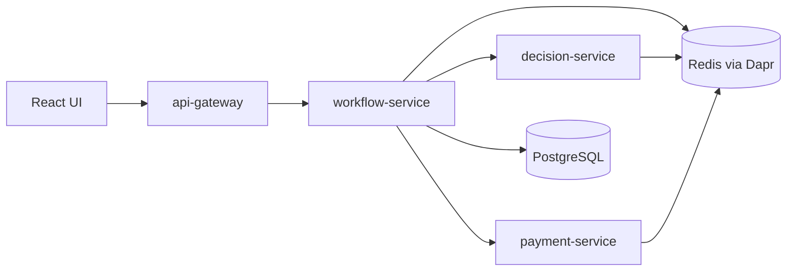

# ApprovalFlow

ApprovalFlow is an invoice and expense approval platform.

The system is designed to receive invoice or expense submissions, check them against company policy, and route each item to the right approval path:
automatic approval, human review, or rejection. Approved items continue to the payment flow.
The core rule is:

> The agent can recommend, but code decides.

An agent may help evaluate a submission, but deterministic code must enforce the final route. Expensive, risky, unclear, incomplete, or suspicious items must not be auto-approved.

## Architecture overview

The platform is split into four backend services and a minimal React UI.



| Component | Responsibility |
|---|---|
| `api-gateway` | External entry point for the UI |
| `workflow-service` | Tracks invoice state and workflow progress |
| `decision-service` | Applies policy checks, agent recommendation, and deterministic guardrails |
| `payment-service` | Handles payment flow and compensation |
| `ui` | Minimal React/Vite frontend |

Detailed architecture: [ARCHITECTURE.md](ARCHITECTURE.md)

## Local run

Create a local `.env` file from `.env.example`, then run:

```bash
docker compose up --build
```

UI: http://localhost:5173  
API Gateway health: http://localhost:8000/health

Stop the system:

```bash
docker compose down
```

## API

Public endpoints on api-gateway:

- `POST /invoices` — submit an invoice. Returns a `tracking_id` and status `received`.
- `GET /invoices/{tracking_id}` — returns the invoice status, details, and the decision once routed, or 404.

Invoices are stored by workflow-service: in PostgreSQL when running with docker compose, in memory otherwise. After submission the invoice is routed asynchronously over Dapr pub/sub (`invoice.received` / `invoice.decided`) to `approved`, `pending_review`, or `rejected`. Routing thresholds live in `data/policy-config.json` and are read from the mounted file, so they can change without rebuilding images. Human review actions, payments, and duplicate detection are not implemented yet.

## Tests

Tests do not require Docker, Dapr, Redis, or PostgreSQL.

Where `make` is available:

```bash
make test
```

On Windows PowerShell, run tests per service:

```powershell
cd services\api-gateway
python -m pytest -q
```

## Documentation

Architecture decisions are documented under:

```text
docs/adr/
```
